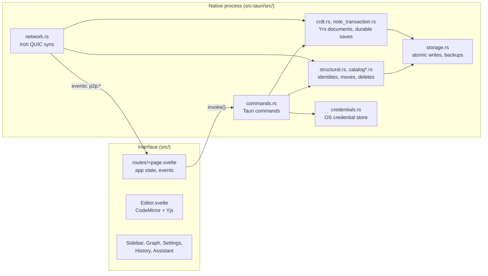

# Architecture

LowNotes is a Tauri 2 application. A Svelte 5 interface runs in the system WebView and talks to a Rust process through Tauri commands and events. The Rust process owns every file in the vault, the collaborative (CRDT) state, credentials and the P2P network.

## Interface (`src/`)

| Area | Files |
| --- | --- |
| Shell and layout | `src/routes/+page.svelte` |
| Shell state: P2P session, presence, updates, recovery notices | `src/lib/state/` |
| In-app dialogs | `src/lib/dialogs.svelte.ts`, `components/AppDialog.svelte` |
| Editor and preview, collaboration, presence | `src/lib/components/Editor.svelte`, `editor-collaboration.ts`, `presence.ts` |
| Markdown rendering (markdown-it, Mermaid) | `src/lib/markdown.ts`, `mermaid-renderer.ts`, `preview-links.ts` |
| Native bridge (every `invoke`) | `src/lib/api.ts`, `src/lib/types.ts` |
| Translations | `src/lib/i18n/` (en-US, pt-BR, es-ES) |
| Word/PDF export, loaded on demand | `document-export.ts`, `docx-export.ts`, `pdf-export.ts` |

The interface never reads the vault directly. Settings arrive through `AppSettings::for_frontend()`, which removes secrets.

## Native process (`src-tauri/src/`)

| Area | Files |
| --- | --- |
| Commands exposed to the interface | `commands.rs`, `history_commands.rs`, `image_upload.rs`, `updates.rs` |
| Settings and credentials | `config.rs`, `credentials.rs` |
| Atomic storage and recovery notices | `storage.rs` |
| Vault listing and paths | `vault.rs` |
| Stable note identities, deletes, moves | `catalog.rs`, `catalog_sync.rs`, `structural.rs`, `creation.rs` |
| Collaborative state and durable saves | `crdt.rs`, `note_transaction.rs` |
| History, trash, retention | `note_history.rs`, `retention.rs` |
| Links, references, map | `links.rs`, `link_operations.rs`, `references.rs`, `reference_sync.rs` |
| Images | `local_images.rs`, `export_images.rs` |
| Assistant | `assistant.rs`, `rag.rs`, `web_search.rs`, `chat_history.rs` |
| P2P sync | `network.rs` |
| Shared HTTP clients | `http.rs` |
| Diagnostic log | `logging.rs` |

### Threads and locks

- Tauri runs synchronous commands on the main thread. IO-heavy commands are `async` and run their body on the blocking pool through `on_worker` in `commands.rs`.
- The network service runs on its own thread with a two-worker Tokio runtime (`NetworkService::start`). Disk and CRDT phases inside network tasks go through `block_in_place`.
- `structural::exclusive` serializes structural work per vault with a reentrant lock and runs pending recovery on the outermost entry.

### Durability

- `storage.rs` writes through a temporary file and atomic replace, keeping a validated `.bak`.
- A save records a durable intent (`note_transaction.rs`) before updating the Yrs state and the Markdown, so an interrupted save completes or is preserved on the next start.
- Creation, moves and link removals use their own pending intents under `.lownotes/`.

## Data on disk

| Location | Content |
| --- | --- |
| Vault folder | Markdown notes, assets |
| `.lownotes/crdt/` | Yrs document state per note |
| `.lownotes/catalog.json` | Structural history: creation, moves, deletions, restores |
| `.lownotes/link-operations.json`, `links.json` | Map link operations and their projection |
| `.lownotes/versions/`, `trash/` | Local history and trash (not synced) |
| App config dir `settings.json` | Preferences and credential references (no secrets) |
| OS credential store | Vault identity, pairing token, provider and search keys |

See [SYNC-PROTOCOL.md](SYNC-PROTOCOL.md) for how vaults converge and [THREAT-MODEL.md](THREAT-MODEL.md) for the security boundaries.
