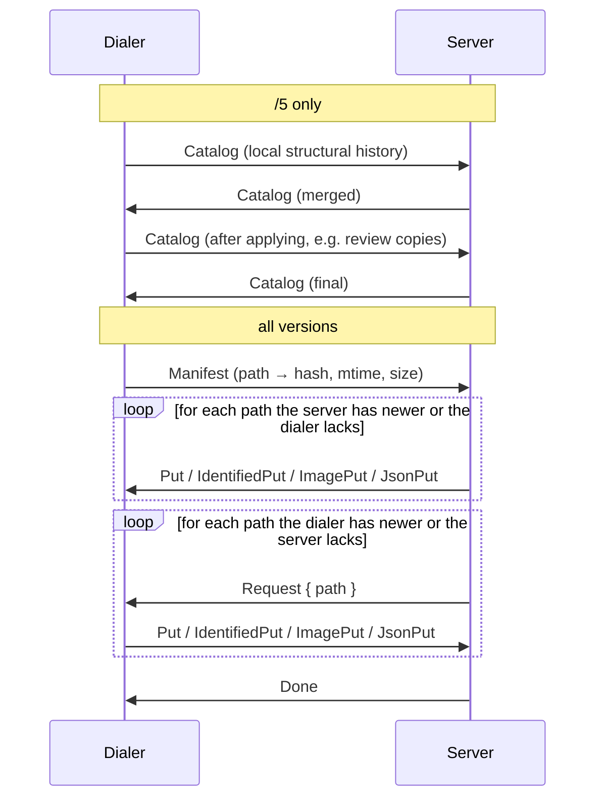

# P2P sync protocol

LowNotes devices synchronize a vault directly over [Iroh](https://www.iroh.computer/) QUIC connections. Every connection is end-to-end encrypted and authenticated by the endpoint's Ed25519 key. Iroh may use relay servers to establish or forward a connection; relays see encrypted traffic only.

Source: `src-tauri/src/network.rs`, with structural logic in `catalog_sync.rs`.

## Identity and pairing

- Each vault has its own Iroh secret key (its **endpoint id**) and a random 128-bit **pairing token**, both stored in the OS credential store.
- A pair code (`LOWNOTES2_...`) encodes the endpoint ticket (id and addresses), the device name, the pairing token, the vault id and the vault name.
- Pairing:
  1. Device B decodes A's code and connects to A with ALPN `lownotes/sync/2`, sending `PairRequest { token, requester }`.
  2. A accepts the request only if the token matches (constant-time comparison) and the requester's ticket names the same endpoint as the connection (`authenticated_requester`). The user approves on A within 120 seconds.
  3. A replies `PairDecision { accepted, responder }`. Both sides store the other in the vault's peer allowlist.
  4. A rotates its pairing token and publishes a new code, so each code pairs one device.
- Only endpoints in the allowlist can sync. An unknown endpoint may send a single `PairRequest` of at most 16 KiB within 30 seconds; anything else is refused before parsing.

## Framing

Each message is a 4-byte big-endian length followed by a JSON-encoded `Packet`. Paired peers may send packets up to 24 MiB; every read has an idle timeout.

## Protocol versions (ALPN)

| ALPN | Adds | Notes |
| --- | --- | --- |
| `lownotes/sync/5` | Structural catalog (stable identities, durable deletes and moves), identified content and CRDT updates | Current |
| `lownotes/sync/4` | Map link operations as JSON | Fallback |
| `lownotes/sync/3` | Immutable image blobs | Fallback |
| `lownotes/sync/2` | Notes; pairing; awareness | Legacy and pairing |

The dialer tries `/5`, then `/4`, `/3` and `/2`. Older peers keep exchanging what they understand; structural operations converge only between `/5` peers.

## Full reconciliation

Runs when the app starts, every 60 seconds per peer, after pairing and on **Sync now**.

- Markdown is compared by hash and modification time; CRDT state and sync metadata by hash.
- `IdentifiedPut` carries the stable note identity, so content follows a note through moves and cannot recreate a deleted note at a reused filename.
- Divergent offline edits are both preserved: one stays in the note, the other becomes `name (conflict <hash>).md`.

## Live collaboration

- Editor changes are applied as Yrs updates and broadcast to connected peers as `IdentifiedCrdt { entry_id, note_path, update_base64 }` (or `CrdtUpdate` for older peers).
- Cursor and selection presence uses `Awareness { note_path, update }`.
- A peer that receives an update for an unknown identity triggers a full reconciliation.

## Packets

| Packet | Direction | Purpose |
| --- | --- | --- |
| `PairRequest`, `PairDecision` | Pairing | See above |
| `Catalog` | Reconciliation | Structural history (`/5`) |
| `Manifest` | Reconciliation | Files and their hashes |
| `Request`, `Done` | Reconciliation | Ask for a path; end of exchange |
| `Put`, `IdentifiedPut`, `ImagePut`, `JsonPut` | Reconciliation | File content by kind |
| `IdentifiedCrdt`, `CrdtUpdate` | Live | Collaborative updates |
| `Awareness` | Live | Presence |
| `Delete` | Legacy | Path deletion from old clients |

## Changing the protocol

- Keep older ALPNs working, or document the minimum compatible version in the README and release notes.
- Add negative tests (unauthorized peer, oversized or malformed packets) next to the existing endpoint tests in `network.rs`.
